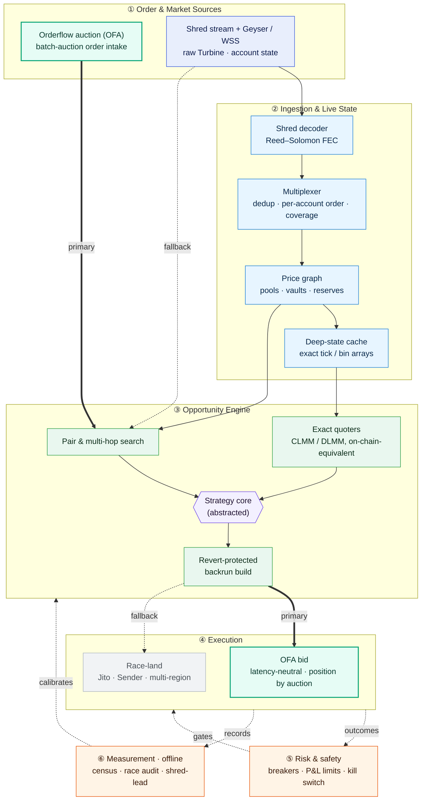

# Solana MEV Searcher

A low-latency, cross-DEX **backrun-arbitrage searcher for Solana** — built and operated in
**Rust**. It maintains a real-time, multi-DEX price graph, prices every route with
**exact, on-chain-equivalent CLMM/DLMM quoters**, and lands **revert-protected** backruns
**orderflow-auction (OFA) first** — position won by a bid, not by the speed race — with
multi-region racing (**Jito bundles**, **Helius Sender**, flashloan-funded) retained as
fallback. **Backrun-only by design: no front-running, no sandwiching.**

This repository is the **public architecture overview** of the system — it shows the
systems engineering, while the strategy core and all tuning parameters are
**deliberately abstracted** (see [below](#deliberately-omitted)). Independent research
infrastructure; **no profit, revenue, or landing-rate figures are claimed**.

## What it does

Maintains a real-time price graph across **Raydium AMM v4, Orca Whirlpool, Pump / PumpSwap
and Meteora DLMM**, detects the transient cross-DEX dislocations that user swaps create,
and submits **revert-protected backruns** to arbitrage them. Also runs **liquidation
detection** (Kamino klend + Scope, MarginFi), record-only.

## Architecture

Six subsystems, from order intake to confirmed P&L. The **primary route is
orderflow-auction (OFA)**: an auction order triggers a priced, revert-protected backrun
submitted as a **bid** (position won in the auction, latency-neutral). The
**shred-reactive** route — detect from the raw feed, then **race to land** — is retained as
**fallback**. The strategy core is abstracted on purpose; the full **low-level design**
(ingestion, detection and execution internals) lives in
**[`docs/ARCHITECTURE.md`](docs/ARCHITECTURE.md)**.

> **Primary route: orderflow-auction (OFA)** — a backrun submitted as a bid, where position
> is won in the auction rather than the 26–67 ms open-market speed race. Shred-reactive
> racing is kept as the fallback. The engine is built around the OFA route.

## On-chain correctness

- **Exact CLMM/DLMM quoters** — full ports of the Orca Whirlpool and Meteora DLMM swap loops (tick- and bin-array traversal, adaptive/variable fees, oracle-aware), equal to the programs' *own* on-chain output on real mainnet pools (verified against `orca-whirlpools-core` and the DLMM SDK).
- A leg that cannot be quoted exactly is **dropped, never approximated** — no x·y=k fallback on pools with plugins. This is how phantom profit is engineered out.
- Zero-copy, `bytemuck`-Pod decoders; byte layouts pinned to canonical IDLs and cross-checked against real mainnet account dumps and a golden-fixture corpus.

## Low-latency architecture

- **Lock-free hot path** — a sharded concurrent price graph with `Arc`-swap state updates, strict per-account ordering, bounded back-pressured channels, a single sequential update consumer feeding a work-stealing opportunity dispatcher. No allocation or locking on the critical path.
- Keyed, content-hashed deduplication at **~18.6 ns per update** (benchmarked), so the ingest firehose never stalls detection.
- **Tiered detection** — O(1) pair-scan on the changed pair, plus a periodic Bellman-Ford negative-cycle search run off-thread, with per-scan memoization and a provably-sound pruning pass.
- **Frankfurt co-location** (~1–2 ms to regional Jito/Helius endpoints), warm connection pooling, and leader- and slot-boundary-aware send timing.
- Every pipeline stage is instrumented with **p50 / p90 / p99 latency percentiles**.

## Transactions & execution

- **Legacy / v0 + ALT / hand-encoded v1 (SIMD-0385)** transactions, golden-tested byte-for-byte against real mainnet v1 transactions; self-managed address-lookup tables; a unique-key account-budget bound computed before every build.
- **Flashloan-funded** (Kamino, MarginFi) with exact on-chain fee accounting, proven by mainnet simulation.
- Compute-unit limits sized from live simulation — cached, shape-learned, or modeled; **atomic, revert-dropping bundles** guarded by an on-chain profit check.

## Robustness & safety

- **Fail-closed everywhere** — landing confirmed by on-chain signature; submission pauses if the chain can't be read; stream-lag and data-freshness gates; automatic stream reconnection with targeted repair reads; a quota governor that throttles cost but never starves discovery.
- **Production safety rails** — per-DEX and global circuit breakers, a kill switch, and persisted hourly / daily / lifetime realized-P&L loss limits restored across restarts.
- Secrets never reach logs, captures, or error text (centralized redaction); overflow-checked arithmetic; typed, classified error handling.

## Engineering discipline

- **Deterministic capture-and-replay** — the production pipeline replays a recorded mainnet stream *byte-identically per build*, so every change is A/B-verifiable offline against real data.
- Shred-level decoding with **Reed-Solomon (FEC) reconstruction** and kernel-timestamped arrival analysis for latency measurement.
- A **record-only, pre-registered-measurement** rollout — nothing goes live until a frozen, pre-registered metric passes. Correctness and measurement before capital.

## Supported venues & integrations

| Layer | Integrations |
|---|---|
| Order flow | **Orderflow auction (OFA) batch-auction intake — primary route**; shred-reactive detection as fallback |
| DEX venues | Raydium AMM v4, Orca Whirlpool (CLMM), Meteora DLMM, Pump / PumpSwap |
| Market data | Geyser gRPC, WebSocket RPC (failover), raw Turbine shred stream, Helius |
| Landing | **OFA bid (primary)**; multi-region race-land — Jito bundles, Helius Sender, bundle proxies — as fallback |
| Capital | Kamino flashloans, MarginFi flashloans |
| Lending / liquidations | Kamino klend + Scope, MarginFi (detection, record-only) |
| Transactions | Legacy, v0 + Address Lookup Tables, v1 (SIMD-0385) |

## Deliberately omitted

This is an architecture overview, not an alpha drop. The omissions below are **intentional
abstraction**, not gaps:

- the **opportunity scoring and route-selection logic** (the "strategy core"),
- all **thresholds, sizing, bid/tip, and timing parameters**,
- the **specific market-structure edges** the searcher targets,
- private keys, endpoints, and operational configuration.

The hard parts of a competitive Solana searcher are **state correctness, exact quoting,
transaction encoding, and landing** — and those are what this repository documents.

## Status

Independent research and engineering project, **built orderflow-auction-first**. _Source is
private; a scoped technical walkthrough is available to partners under NDA._ No profit,
revenue, or landing-rate figures are claimed here — performance claims are intentionally
out of scope.

---

**Topics:** solana · mev · mev-bot · mev-searcher · arbitrage · backrun ·
orderflow-auction · ofa · defi · jito · rust · dex · amm · clmm · dlmm · flashloan ·
trading-infrastructure · low-latency · raydium · orca · meteora
