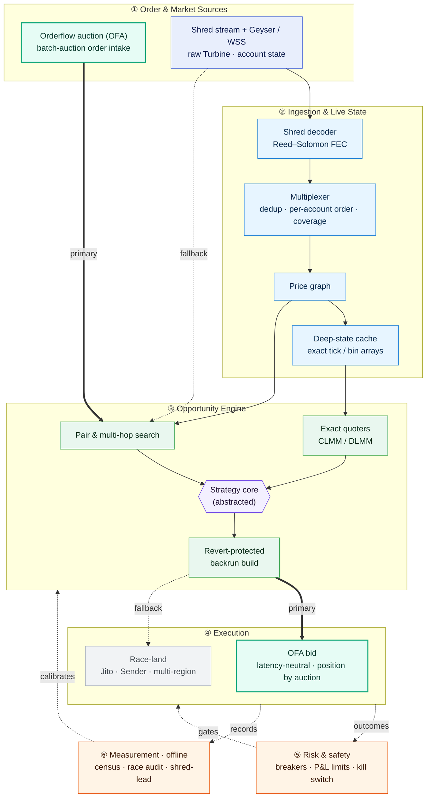
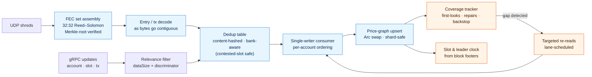
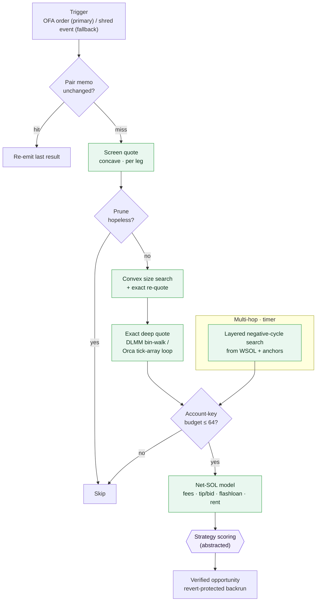
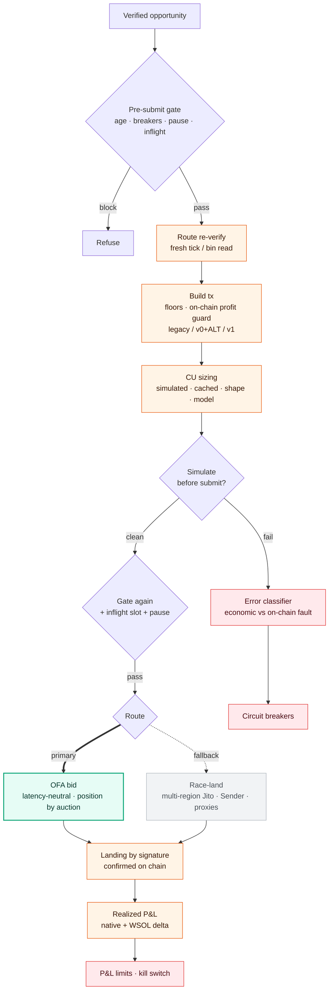

# Architecture — Solana MEV Searcher

High-level design (HLD) and low-level design (LLD) for a low-latency **Solana MEV /
cross-DEX backrun-arbitrage** engine in **Rust**, routed **orderflow-auction-first**. The
strategy core and all tuning parameters are **abstracted** on purpose (see
[Abstraction boundary](#abstraction-boundary)); everything shown is the systems
engineering that makes a competitive **Solana searcher** correct and fast.

- [1. High-level design](#1-high-level-design)
- [2. Low-level design](#2-low-level-design)
  - [2.1 Ingestion &amp; live state](#21-ingestion--live-state)
  - [2.2 Opportunity engine](#22-opportunity-engine)
  - [2.3 Execution &amp; landing](#23-execution--landing)
- [3. Abstraction boundary](#3-abstraction-boundary)

---

## 1. High-level design

Six subsystems on one data path. The **primary route is orderflow-auction (OFA)**: an
auction order triggers a priced, revert-protected backrun submitted as a **bid** (position
won in the auction, latency-neutral). The **shred-reactive** route — detect from the raw
feed, then **race to land** — is retained as **fallback**. Both share the same state
engine, exact quoters, risk gates and measurement.

| # | Subsystem | Responsibility |
|---|---|---|
| ① | Order &amp; market sources | **Primary:** orderflow-auction (OFA) order intake. **Fallback trigger + shared state:** raw Turbine shreds, Geyser gRPC, WebSocket RPC. |
| ② | Ingestion &amp; state | FEC recovery, dedup, strict per-account ordering, coverage/repair, into a concurrent price graph and an exact deep-state cache. |
| ③ | Opportunity engine | Pairwise and multi-hop search over **exact** quotes; candidate scoring by the abstracted strategy core; revert-protected backrun build. |
| ④ | Execution | **Primary:** OFA bid — latency-neutral, position won in the auction. **Fallback:** race-land via Jito / Helius Sender / bundle proxies. |
| ⑤ | Risk &amp; safety | Pre- and post-send gates: breakers, realized-P&amp;L limits, persisted kill switch. |
| ⑥ | Measurement | Offline census, race/landing audits, and latency analysis that calibrate the engine. |

---

## 2. Low-level design

### 2.1 Ingestion &amp; live state

The correctness-critical layer. Two wire formats (decoded shreds and gRPC updates)
converge into one strictly-ordered state writer. The design rule is **never discard live
data for being late** — ordering is enforced per account, not by a global clock.

**What's hard here:** reconstructing blocks from a lossy shred feed fast enough to matter;
deduplicating across two feeds *and* across Alpenglow contested slots (where a
`(pubkey, slot)` pair no longer identifies a single state, so the key must be content and
bank); and guaranteeing that out-of-order arrivals never overwrite newer state, without a
global lock on the hot path.

### 2.2 Opportunity engine

Detection runs on every relevant state change, but the expensive work is fenced behind
cheap screens: a per-pair memo short-circuits unchanged pairs, a concavity-based prune
discards hopeless pairs before any exact quote, and only survivors reach the
**on-chain-equivalent** quoters.

**What's hard here:** the quoters are full reimplementations of the DEX programs' swap
math (tick arrays, bin arrays, adaptive fees, oracle timing), so a route that *detects*
positive actually *executes* positive. The pruning must be provably sound — it is only
valid while every screen is concave and non-decreasing — or it would silently drop real
routes. The account-key budget models the compiled transaction's unique-key bound *before*
building, so no work is wasted on a route that can't fit in one transaction.

### 2.3 Execution &amp; landing

From verified opportunity to confirmed P&amp;L. Gated twice (once before building, once
after simulation and before the irreversible send), landed by **signature**, and every
outcome classified so the breakers and limits see the truth. The send is routed
**primary-first**: an **OFA bid** (position won in the auction) with multi-region
**race-landing** as fallback.

**What's hard here:** encoding three transaction versions by hand (the v1 / SIMD-0385 wire
format has no SDK support) and keeping instruction indices stable so flashloan sysvar
checks still pass; sizing compute units from live simulation with cached and modelled
fallbacks; routing sends against a leader clock reconstructed from block footers; and
treating landing as **fail-closed** — an unreadable landing or P&amp;L pauses the engine
rather than guessing.

---

## 3. Abstraction boundary

Everything above is the *mechanism*. The *policy* — what makes it a strategy rather than a
plumbing demo — is intentionally not published:

- the **strategy core** (how opportunities are scored, ranked, and selected),
- **sizing, bid/tip, timing, and risk parameters**,
- the **specific market structure edges** the engine targets,
- keys, endpoints, and deployment configuration.

The **primary route is orderflow-auction (OFA)** participation via latency-neutral
**batch auctions** — position won by a bid, not by the open-market speed race — with
shred-reactive racing retained as fallback. The engine is built around this route and
**ready to integrate with an auction**; it is documented here at the architecture level
only, and runs record-only until a pre-registered metric passes.
